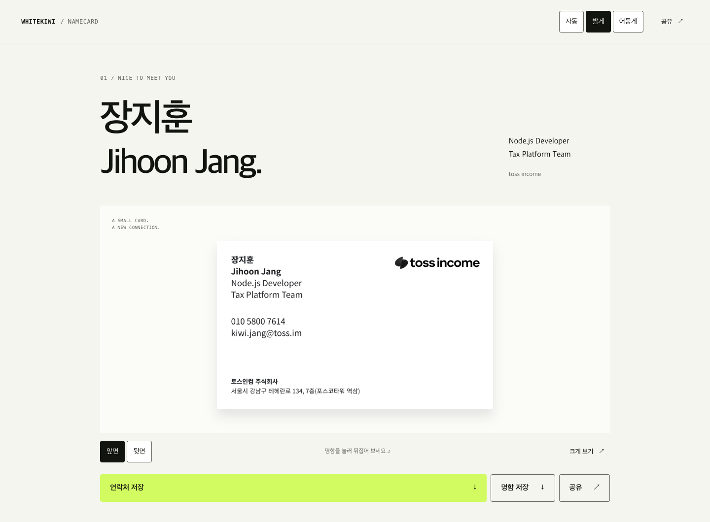
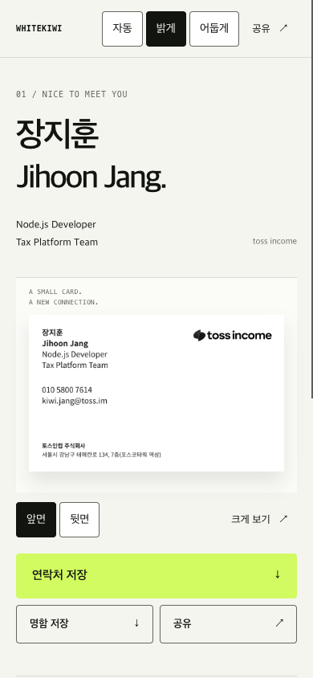

<h1 align="center">Namecard</h1>

<p align="center">
  <strong>A small card. A new connection.</strong><br>
  한 장의 명함에서, 다음 만남까지. 장지훈의 개인 디지털 명함.
</p>

<p align="center">
  <a href="https://namecard.whitekiwi.link">명함 열기 ↗</a> ·
  <a href="#직접-실행하기">직접 실행하기</a> ·
  <a href="docs/DEVELOPMENT.md">개발 안내</a> ·
  <a href="docs/CI-CD.md">CI · 릴리스</a>
</p>

<p align="center">
  <a href="https://github.com/WhiteKiwi/namecard/actions/workflows/ci.yml"></a>
  <a href="https://github.com/WhiteKiwi/namecard/releases"></a>
  <a href="https://design.whitekiwi.link"></a>
</p>

<picture>
  <source media="(prefers-color-scheme: dark)" srcset="docs/images/desktop-dark.png">
  
</picture>

## 명함이 이어주는 것

실물 명함의 앞·뒷면을 웹에서 보고, 필요한 정보를 바로 저장하거나 공유합니다.
따뜻한 여백과 선명한 타이포그래피, 키위색 행동 버튼은 [PIP](https://design.whitekiwi.link)의 시각 언어를 따릅니다.

| 보기 | 저장하기 | 연결하기 |
| --- | --- | --- |
| 명함 앞·뒷면 전환과 확대 | 앞·뒷면 고해상도 PNG | 전화·이메일과 항목별 복사 |
| 자동 · 밝게 · 어둡게 테마 | vCard 3.0 연락처 | 기기 공유창 또는 링크 복사 |
| 반응형 화면과 키보드 조작 | 정적 OG · Twitter 미리보기 | Portfolio · GitHub · LinkedIn · Blog |

<details>
<summary><strong>작은 화면에서도, 같은 명함</strong></summary>

<p align="center">
  
</p>

데스크톱·모바일 이미지는 이 저장소를 로컬에서 빌드해 촬영한 실제 화면입니다.
명함 이미지는 제공된 실물 사진을 바탕으로 재구성했으며, 인쇄 원본의 서체·치수·종이 질감과 완전히 같지는 않습니다.

</details>

## 직접 실행하기

**Node.js 24**, **pnpm 11.25.0**을 사용합니다. 별도의 서버 애플리케이션이나 DB는 필요하지 않습니다.

```sh
git clone https://github.com/WhiteKiwi/namecard.git
cd namecard
pnpm install --frozen-lockfile
pnpm build
pnpm check
```

빌드 결과는 `dist/`에 생성됩니다. Python 3이 있다면 로컬에서 바로 열 수 있습니다.

```sh
python3 -m http.server 4173 --bind 127.0.0.1 --directory dist
# http://127.0.0.1:4173
```

소스를 고친 뒤 `pnpm build`를 다시 실행하고 새로고침합니다.
로컬 주소에서는 GA4를 로드하지 않습니다.

## 작고 단순한 구조

```text
config.json        연락처 · 프로필 링크 · 공개 URL · 분석 설정
artwork.json       검토한 명함 도안의 콘텐츠 기준
src/               정적 HTML · CSS · 브라우저 JavaScript
public/            명함 SVG/PNG · 공유 이미지 · 라이선스 고지
scripts/           빌드 · 콘텐츠 검증 · 릴리스 패키징
tests/             입력 검증 · vCard 회귀 테스트
```

브라우저에는 HTML/CSS/JavaScript와 PIP의 CSS만 전달합니다.
`@whitekiwi/tokens`와 `@whitekiwi/ui`는 같은 **0.2.1** 버전의 CSS export를 사용하며 React JavaScript를 로드하지 않습니다.
테마 저장, 명함 상태, 연락처와 분석 이벤트는 이 앱에서 관리합니다.

## 콘텐츠와 분석

`config.json`이 연락처와 링크의 기준입니다. 명함에 인쇄된 정보는 이미지에도 있으므로
설정과 도안을 함께 갱신해야 합니다. 빌드는 `artwork.json`과 설정이 다르면 실패합니다.
[수정할 파일과 도안 생성 방법](docs/DEVELOPMENT.md#콘텐츠-수정)을 먼저 확인하세요.

GA4는 설정한 운영 origin에서만 동작합니다. 앱 이벤트에는 전화번호·이메일 값,
URL query와 referrer를 넣지 않습니다. 분석을 끄려면 `gaMeasurementId`를 빈 문자열로 설정합니다.
[이벤트 범위와 GA 설정](docs/DEVELOPMENT.md#분석-설정)에 수집 경계를 정리했습니다.

## 검증에서 릴리스까지

공개 저장소의 PR과 `main`은 GitHub-hosted Ubuntu에서 frozen install → build → check를 실행합니다.
`v*` 태그는 `main`에 포함된 소스와 패키지 버전이 일치할 때만 검증된 정적 파일,
파일별 manifest, SHA-256 체크섬을 GitHub Release에 게시합니다.
운영 사이트 활성화는 별도 단계입니다. [CI와 릴리스 안내](docs/CI-CD.md)에서 확인하세요.

## 출처와 사용 범위

이 저장소는 개인 명함 사이트입니다. 연락처·회사명·도안을 범용 예제로 간주하지 마세요.
앱 자체에는 아직 오픈소스 라이선스를 부여하지 않았습니다.
PIP의 MIT 고지는 [PIP-LICENSE.txt](public/PIP-LICENSE.txt)에 보존합니다.
Toss 로고·상표와 명함 자산은 별도 권리 범위이며, PIP의 MIT 라이선스가 적용되지 않습니다.

[PIP](https://github.com/WhiteKiwi/kiwi-design-system) ·
[Toss 브랜드 리소스와 사용 규정](https://brand.toss.im/) ·
[자산별 출처](docs/ASSETS.md) · [보안 제보](SECURITY.md)
